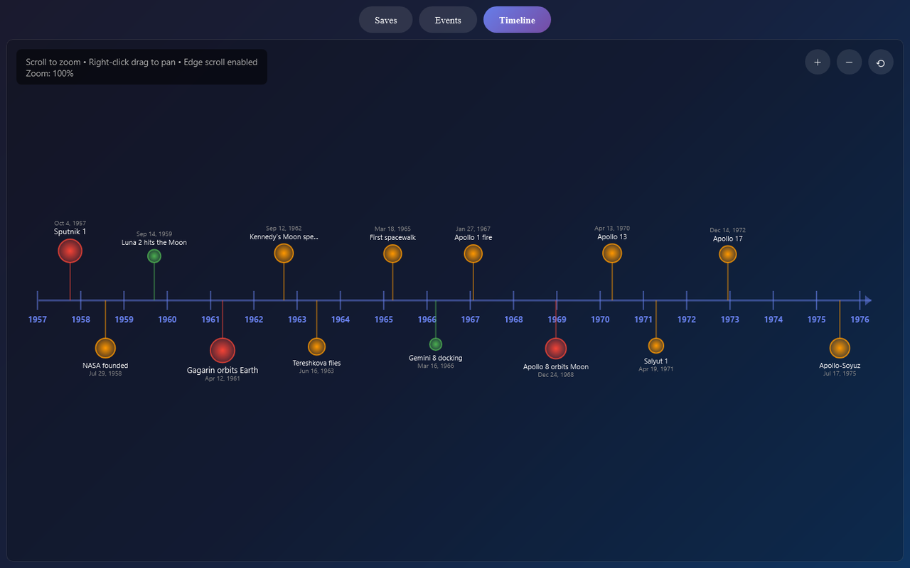
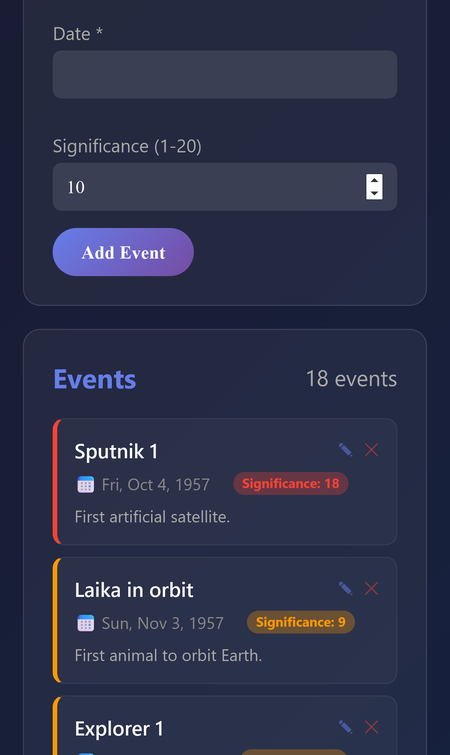

# Timeline

Put events on a zoomable timeline. Add each event with a date and how much it matters, and the big ones stand out while the small ones appear as you zoom in.

**[▶ Open the live app](https://timothyhadfield.github.io/timeline/)** · best on a laptop (zoom and pan use the mouse wheel and right-click drag)

  
  &nbsp;
  

## Features
- **Zoomable timeline**: scroll to zoom from decades down to single days; the scale switches between years, months and days on its own.
- **Significance 1 to 20**: bigger events get bigger, redder dots and stay visible when zoomed out; minor ones show up as you zoom in and never overlap.
- **Pan around**: right-click drag, the edge of the screen, or the +, − and reset buttons.
- **Several timelines**: create, rename, switch between and delete separate timelines ("World History", "My Life", ...).
- **Event list**: add, edit and delete events with an optional description, sorted by date.
- **Saves automatically** in your browser; nothing to sign up for.

## Built with
One HTML file: plain JavaScript, a canvas for the timeline, and localStorage for saving.
